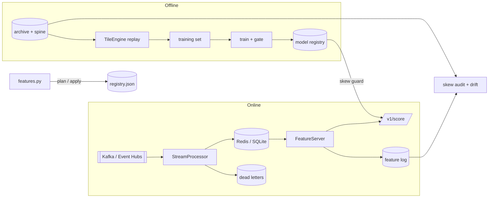

# Tessera

**A feature platform for real-time ML in which training and serving values agree exactly.**

Define features once in Python: windowed aggregations over event streams,
slowly changing profile tables, and request-time transforms. Tessera computes
point-in-time correct training sets offline and serves the same features
online in about a millisecond. Both paths run the same tiled aggregation
engine. Training/serving skew is therefore removed by construction, then
measured continuously in production by replaying served vectors offline.

```
clean replay of a live day:  1,524 served vectors x 23 features → 0 mismatches vs offline
same day, 2% of events 20 min late:  0.50% of values differ → audit names the features and entities
```

## Why

Most real-time ML stacks compute features twice: SQL or Spark for training,
and a stream job with a cache for serving. The two drift apart quietly, through
an off-by-one window edge, `NaN` versus `null`, or a late event counted on one
side only. The model then underperforms in production without any error being
raised. Tessera has one implementation of window semantics and treats any
remaining skew as an operational incident with a cause.

## Features

| | |
|---|---|
| **Declarative definitions** | Entities, batch and stream sources, aggregate, snapshot and on-demand views, and versioned feature services ([example](examples/fraud/features.py)) |
| **Tiled sawtooth windows** | Mergeable monoid states (`count/sum/mean/min/max/std/last`, HyperLogLog `count_distinct`) at several resolutions. Exact for the most recent events, bounded state per entity ([ADR-0001](docs/adr/0001-tiled-sawtooth-windows.md)) |
| **Point-in-time training sets** | Offline values are computed by replaying the online engine. No future leakage, and the event being scored is excluded ([ADR-0002](docs/adr/0002-offline-by-replay.md)). Also runs distributed on Spark |
| **Stream ingestion** | Kafka / Event Hubs, at-least-once with event-id dedupe, allowed lateness, dead letters, compare-and-set writes with retry ([ADR-0003](docs/adr/0003-cas-writes-and-at-least-once.md)) |
| **Plan / apply** | Terraform-style diff of definitions. Changed views get a fresh, fingerprinted online namespace and are flagged for backfill ([ADR-0004](docs/adr/0004-fingerprinted-namespaces-and-skew-guard.md)) |
| **Skew guard** | Models record the service fingerprint they were trained on, and the API refuses to start against different definitions |
| **Training and gating** | Out-of-time split with a gap, an IRLS logistic baseline, cost-based threshold, AP, recall at 1% FPR and ECE, and a promotion gate against production. Artifacts are JSON, never pickles ([ADR-0005](docs/adr/0005-json-artifacts-and-a-linear-baseline.md)) |
| **Monitoring** | A skew audit of logged vectors, PSI drift against the training reference, and Prometheus metrics for stream lag, late and invalid events, and latency |
| **Data quality** | Source checks (`not_null`, `unique`, `between`, `in_set`, `regex`) with `mostly` and severity. They gate backfills and training sets |
| **Serving API** | FastAPI: features, scoring with per-feature explanations, push ingestion, `/metrics`, API keys |
| **Platform** | Docker, docker-compose (Redpanda and Redis), a Helm chart (HPA, PDB, workload identity, Key Vault CSI), Terraform for Azure (AKS, Event Hubs, Redis, ADLS Gen2, Key Vault), Airflow DAG, Spark job, GitHub Actions |

## Quickstart

```bash
python -m venv .venv && . .venv/bin/activate
pip install -e ".[dev]"

python examples/fraud/generate_data.py          # 44k synthetic card transactions, 1.2% fraud
python examples/fraud/run_demo.py               # train → backfill → stream a live day → audit
```

Or step by step with the CLI. The `make` targets wrap the same commands:

```bash
export TESSERA_CONFIG=examples/fraud/tessera.yaml
tessera plan                                      # what would change vs the registry
tessera apply
tessera validate                                  # data quality checks on every source
tessera backfill                                  # build online state from the archives
tessera build-dataset --service fraud_v1 --spine examples/fraud/data/spine.csv \
                      --out .tessera/datasets/fraud_v1.csv
tessera train --name card_fraud --service fraud_v1 --label is_fraud \
              --dataset .tessera/datasets/fraud_v1.csv --promote
tessera serve                                     # http://localhost:8080/docs
```

```bash
curl -s localhost:8080/v1/models/card_fraud/score -H 'content-type: application/json' -d '{
  "rows": [{"card_id": "c00042", "merchant_id": "m0007", "amount": 640.0,
            "merchant_country": "BR", "channel": "online"}],
  "explain": true}'
```

## Defining features

```python
card_txn = AggregateFeatureView(
    name="card_txn",
    entity=card,
    source=transactions,                 # StreamSource: Kafka topic + lake archive
    granularity="5m",
    transform=_flags,                    # row-level: is_online, is_night
    aggregates=(
        Aggregate(None, "count", "10m"),
        Aggregate("amount", "sum", "1h"),
        Aggregate("amount", "mean", "30d"),
        Aggregate("merchant_id", "count_distinct", "1d"),
        ...
    ),
)

@on_demand(request=(Field("amount", "float"), ...), outputs=(...), depends_on=(card_txn, card_profile))
def txn_context(row):
    mean_30d = row["card_txn__amount_mean_30d"]
    return {"amount_vs_card_mean": row["amount"] / mean_30d if mean_30d else 1.0, ...}

fraud_v1 = FeatureService("fraud_v1", features=(card_txn, merchant_txn,
                          card_profile.select("credit_limit", "account_age_days"), txn_context))
```

Windows cover `[align(t, hop) - window, t)`. The event at exactly `t` (the one
being scored) is excluded, and the same rule holds offline and online.

## Results on the example

Output of `python examples/fraud/run_demo.py` on the default generated
dataset (1,200 cards, 300 merchants, 28 days). The first 27 days train the
model with an out-of-time test split, and the last day is replayed live:

| Out-of-time test set (8,887 rows, 2.3% fraud) | ROC AUC | Avg precision | Recall @ 1% FPR |
|---|---|---|---|
| All 23 features | 0.990 | 0.957 | 0.951 |
| Request + profile features only (6) | 0.968 | 0.703 | 0.892 |

| Online / offline agreement | Mismatch rate |
|---|---|
| Live day, events delivered on time | 0.000000 (0 of 35,052 values) |
| Live day, 2% of events delivered 20 min late | 0.004964, mostly `merchant_txn__*`; busy merchants push late events past the 10-minute lateness bound |

| Performance (one laptop core, Python 3.13) | |
|---|---|
| Training set: 42,446 rows x 23 features | 6.8 s |
| Online retrieval, one row, in process (memory / SQLite store) | p50 0.85 / 0.92 ms, p99 2.0 / 2.1 ms |

The data is synthetic, with two planted fraud patterns (account-takeover
bursts and card-testing merchants), so the absolute model numbers are
optimistic. What carries over is the comparison: windowed features find what
single-transaction features cannot. Latency excludes HTTP and the network
hop to Redis.

## Architecture



More detail: [docs/architecture.md](docs/architecture.md) · [runbook](docs/runbook.md) · [ADRs](docs/adr/)

## API

| Method | Path | |
|---|---|---|
| `GET` | `/healthz`, `/readyz` | liveness; readiness checks the store and loaded models |
| `GET` | `/v1/registry` | views and services with fingerprints |
| `POST` | `/v1/features` | feature vectors for up to 1,000 rows |
| `POST` | `/v1/models/{name}/score` | features, score, decision and optional explanation |
| `POST` | `/v1/ingest/{source}` | push events (low-volume sources, backfills, tests) |
| `GET` | `/metrics` | Prometheus |

## Repository layout

```
src/tessera/
  definitions.py   entities, sources, views, services, fingerprints
  repository.py    load definitions, plan/apply
  aggregation.py   mergeable aggregation states (incl. HyperLogLog)
  tiles.py         per-entity tiled state: apply, read, prune, dedupe
  offline.py       point-in-time training sets
  online/          stores (memory, SQLite, Redis), writer, feature server
  streaming.py     stream processor, in-memory bus, dead letters
  kafka.py         confluent-kafka adapter (Event Hubs config helper)
  training/        metrics, preprocessing + logistic model, artifacts, registry, gate
  monitoring.py    skew audit, PSI drift
  quality.py       source data quality checks
  api.py  cli.py  config.py  metrics.py  jobs.py  mlops.py
examples/fraud/    definitions, data generator, end-to-end demo
pipelines/         Airflow DAG, Spark training-set job
deploy/helm/       Helm chart
infra/terraform/   Azure infrastructure
tests/             unit, property-style parity and end-to-end tests
```

## Development

```bash
make lint typecheck test      # ruff, mypy --strict, pytest (coverage gate 85%)
```

CI runs those on Python 3.10 to 3.13. It also runs the full demo in
`--strict` mode, which fails the build on any skew in the clean replay, plus
a Docker build with a smoke test, `terraform validate` and `helm lint`.

## License

MIT
